[Overview](#over)[platform](#platform)[identity](#identity)[crm](#crm)[catalog](#catalog)[inventory](#inventory)[quotes](#quotes)[sales](#sales)[projects](#projects)[maintenance](#maintenance)[consulting](#consulting)[billing](#billing)

# TCOIN SOLAR UG: Entity Relationship Diagrams

Generated from schema.sql: 99 tables in 11 modules, 186 foreign keys, 13 views. Each diagram shows primary keys, foreign keys, and the first three other columns. Tables from other modules appear as key-only stubs. The full column list is in data-dictionary.xlsx.

## Module dependencies (foreign keys between schemas)

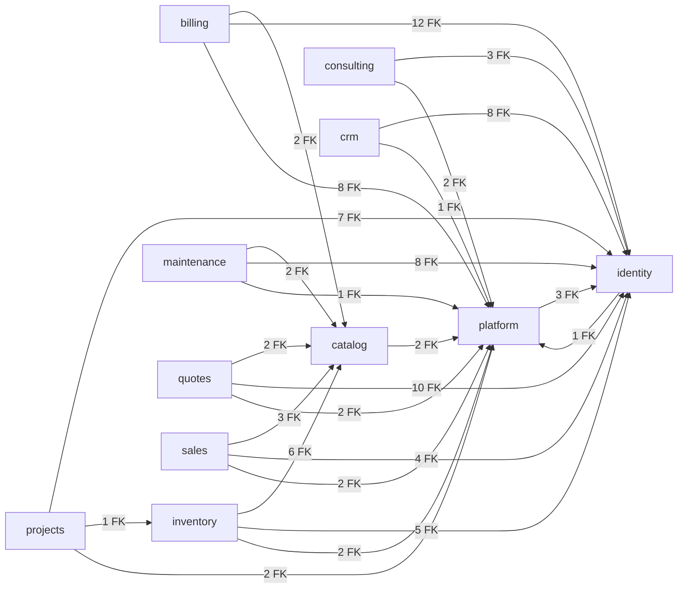

## platform (16 tables)

currency, exchange_rate, setting, number_sequence, audit_log, outbox_event, idempotency_key, document, document_template, notification_template, notification, sync_device, cms_page, number_series, signatory, letter

```mermaid
erDiagram
  platform_currency {
    char code PK
    text name
    text symbol
    smallint decimals
  }
  platform_exchange_rate {
    uuid id PK
    char base_ccy FK
    char quote_ccy FK
    numeric rate
    date valid_on
    text source
  }
  platform_setting {
    text key PK
    jsonb value
    text description
    uuid updated_by
  }
  platform_number_sequence {
    text prefix PK
    integer year PK
    bigint last_value
  }
  platform_audit_log {
    bigserial id PK
    timestamptz at
    uuid actor_id
    text action
  }
  platform_outbox_event {
    uuid id PK
    text aggregate_type
    uuid aggregate_id
    text event_type
  }
  platform_idempotency_key {
    text scope PK
    text key PK
    text request_hash
    integer status_code
    jsonb response
  }
  platform_document {
    uuid id PK
    text owner_type
    uuid owner_id
    text doc_type
  }
  platform_document_template {
    uuid id PK
    text code
    text name
    text kind
  }
  platform_notification_template {
    uuid id PK
    text code
    text channel
    text locale
  }
  platform_notification {
    uuid id PK
    uuid user_id
    uuid customer_id
    text channel
  }
  platform_sync_device {
    uuid id PK
    uuid user_id
    text device_name
    text user_agent
  }
  platform_cms_page {
    uuid id PK
    text slug
    text title
    text page_type
  }
  platform_number_series {
    text doc_type PK
    text division_code PK
    text prefix
    boolean include_year
    smallint pad
  }
  platform_signatory {
    uuid id PK
    uuid user_id FK
    text display_name
    text job_title
    uuid signature_document_id
  }
  platform_letter {
    uuid id PK
    text division_code
    text our_ref
    text your_ref
    uuid customer_id FK
    uuid signatory_id FK
    uuid issued_by FK
  }
  billing_credit_note {
    uuid id PK
  }
  billing_invoice {
    uuid id PK
  }
  billing_payment {
    uuid id PK
  }
  billing_payment_attempt {
    uuid id PK
  }
  billing_payment_plan {
    uuid id PK
  }
  billing_payment_voucher {
    uuid id PK
  }
  billing_receipt {
    uuid id PK
  }
  catalog_price_list {
    uuid id PK
  }
  catalog_variant {
    uuid id PK
  }
  consulting_booking {
    uuid id PK
  }
  consulting_consultation_service {
    uuid id PK
  }
  crm_opportunity {
    uuid id PK
  }
  identity_customer {
    uuid id PK
  }
  identity_user_account {
    uuid id PK
  }
  inventory_purchase_order {
    uuid id PK
  }
  inventory_supplier {
    uuid id PK
  }
  maintenance_service_contract {
    uuid id PK
  }
  projects_project {
    uuid id PK
  }
  projects_project_cost {
    uuid id PK
  }
  quotes_quote {
    uuid id PK
  }
  sales_cart {
    uuid id PK
  }
  sales_sales_order {
    uuid id PK
  }
  platform_currency ||--o{ platform_exchange_rate : "base_ccy"
  platform_currency ||--o{ platform_exchange_rate : "quote_ccy"
  platform_currency ||--o{ identity_customer : "preferred_currency"
  platform_currency ||--o{ crm_opportunity : "currency"
  platform_currency |o--o{ catalog_variant : "cost_currency"
  platform_currency ||--o{ catalog_price_list : "currency"
  platform_currency |o--o{ inventory_supplier : "currency"
  platform_currency ||--o{ inventory_purchase_order : "currency"
  platform_currency ||--o{ quotes_quote : "currency"
  platform_currency ||--o{ sales_cart : "currency"
  platform_currency ||--o{ sales_sales_order : "currency"
  platform_currency ||--o{ projects_project : "currency"
  platform_currency ||--o{ projects_project_cost : "currency"
  platform_currency ||--o{ maintenance_service_contract : "currency"
  platform_currency ||--o{ consulting_consultation_service : "currency"
  platform_currency ||--o{ consulting_booking : "currency"
  platform_currency ||--o{ billing_invoice : "currency"
  platform_currency ||--o{ billing_payment_attempt : "currency"
  platform_currency ||--o{ billing_payment : "currency"
  platform_currency ||--o{ billing_payment_plan : "currency"
  platform_currency ||--o{ billing_credit_note : "currency"
  identity_user_account ||--o{ platform_signatory : "user_id"
  platform_signatory |o--o{ quotes_quote : "signatory_id"
  platform_currency ||--o{ billing_receipt : "currency"
  platform_signatory |o--o{ billing_receipt : "signatory_id"
  platform_currency ||--o{ billing_payment_voucher : "currency"
  identity_customer |o--o{ platform_letter : "customer_id"
  platform_signatory |o--o{ platform_letter : "signatory_id"
  identity_user_account |o--o{ platform_letter : "issued_by"
```

## identity (8 tables)

organization, customer, contact, user_account, role, permission, role_permission, user_role

```mermaid
erDiagram
  identity_organization {
    uuid id PK
    text code
    text name
    uuid parent_id FK
    text address
  }
  identity_customer {
    uuid id PK
    text customer_no
    text customer_type
    text display_name
    char preferred_currency FK
  }
  identity_contact {
    uuid id PK
    uuid customer_id FK
    text full_name
    citext email
    text phone
  }
  identity_user_account {
    uuid id PK
    text user_type
    citext email
    text phone
    uuid customer_id FK
    uuid contact_id FK
    uuid branch_id FK
  }
  identity_role {
    uuid id PK
    text code
    text name
    text description
  }
  identity_permission {
    uuid id PK
    text code
    text description
  }
  identity_role_permission {
    uuid role_id PK
    uuid permission_id PK
  }
  identity_user_role {
    uuid user_id PK
    uuid role_id PK
  }
  billing_credit_note {
    uuid id PK
  }
  billing_invoice {
    uuid id PK
  }
  billing_payment {
    uuid id PK
  }
  billing_payment_attempt {
    uuid id PK
  }
  billing_payment_plan {
    uuid id PK
  }
  billing_payment_voucher {
    uuid id PK
  }
  billing_receipt {
    uuid id PK
  }
  consulting_booking {
    uuid id PK
  }
  consulting_engagement {
    uuid id PK
  }
  crm_activity {
    uuid id PK
  }
  crm_customer_site {
    uuid id PK
  }
  crm_lead {
    uuid id PK
  }
  crm_opportunity {
    uuid id PK
  }
  inventory_goods_receipt {
    uuid id PK
  }
  inventory_purchase_order {
    uuid id PK
  }
  inventory_stock_movement {
    uuid id PK
  }
  inventory_warehouse {
    uuid id PK
  }
  maintenance_asset {
    uuid id PK
  }
  maintenance_service_contract {
    uuid id PK
  }
  maintenance_ticket {
    uuid id PK
  }
  maintenance_visit_report {
    uuid id PK
  }
  maintenance_work_order {
    uuid id PK
  }
  platform_currency {
    char code PK
  }
  platform_letter {
    uuid id PK
  }
  platform_signatory {
    uuid id PK
  }
  projects_checklist_response {
    uuid id PK
  }
  projects_commissioning_record {
    uuid id PK
  }
  projects_crew {
    uuid id PK
  }
  projects_crew_member {
    uuid crew_id PK
    uuid user_id PK
  }
  projects_project {
    uuid id PK
  }
  projects_task {
    uuid id PK
  }
  quotes_energy_profile {
    uuid id PK
  }
  quotes_quote {
    uuid id PK
  }
  quotes_quote_version {
    uuid id PK
  }
  quotes_site_survey {
    uuid id PK
  }
  quotes_system_design {
    uuid id PK
  }
  sales_cart {
    uuid id PK
  }
  sales_delivery_note {
    uuid id PK
  }
  sales_sales_order {
    uuid id PK
  }
  identity_organization |o--o{ identity_organization : "parent_id"
  platform_currency ||--o{ identity_customer : "preferred_currency"
  identity_customer ||--o{ identity_contact : "customer_id"
  identity_customer |o--o{ identity_user_account : "customer_id"
  identity_contact |o--o{ identity_user_account : "contact_id"
  identity_organization |o--o{ identity_user_account : "branch_id"
  identity_role ||--o{ identity_role_permission : "role_id"
  identity_permission ||--o{ identity_role_permission : "permission_id"
  identity_user_account ||--o{ identity_user_role : "user_id"
  identity_role ||--o{ identity_user_role : "role_id"
  identity_customer ||--o{ crm_customer_site : "customer_id"
  identity_customer |o--o{ crm_lead : "customer_id"
  identity_user_account |o--o{ crm_lead : "assigned_to"
  identity_organization |o--o{ crm_lead : "branch_id"
  identity_customer ||--o{ crm_opportunity : "customer_id"
  identity_user_account |o--o{ crm_opportunity : "owner_id"
  identity_user_account |o--o{ crm_activity : "assigned_to"
  identity_user_account |o--o{ crm_activity : "created_by"
  identity_organization |o--o{ inventory_warehouse : "branch_id"
  identity_user_account |o--o{ inventory_purchase_order : "created_by"
  identity_user_account |o--o{ inventory_purchase_order : "approved_by"
  identity_user_account |o--o{ inventory_goods_receipt : "received_by"
  identity_user_account |o--o{ inventory_stock_movement : "created_by"
  identity_customer ||--o{ quotes_site_survey : "customer_id"
  identity_user_account |o--o{ quotes_site_survey : "surveyor_id"
  identity_customer |o--o{ quotes_energy_profile : "customer_id"
  identity_customer ||--o{ quotes_system_design : "customer_id"
  identity_user_account |o--o{ quotes_system_design : "created_by"
  identity_user_account |o--o{ quotes_system_design : "approved_by"
  identity_customer ||--o{ quotes_quote : "customer_id"
  identity_user_account |o--o{ quotes_quote : "owner_id"
  identity_user_account |o--o{ quotes_quote_version : "discount_approved_by"
  identity_user_account |o--o{ quotes_quote_version : "created_by"
  identity_user_account |o--o{ sales_cart : "user_id"
  identity_customer ||--o{ sales_sales_order : "customer_id"
  identity_customer ||--o{ projects_project : "customer_id"
  identity_user_account |o--o{ projects_project : "manager_id"
  identity_user_account |o--o{ projects_task : "assigned_to"
  identity_user_account |o--o{ projects_crew : "lead_user_id"
  identity_user_account ||--o{ projects_crew_member : "user_id"
  identity_user_account |o--o{ projects_checklist_response : "answered_by"
  identity_user_account |o--o{ projects_commissioning_record : "commissioned_by"
  identity_customer ||--o{ maintenance_asset : "customer_id"
  identity_customer ||--o{ maintenance_service_contract : "customer_id"
  identity_customer ||--o{ maintenance_ticket : "customer_id"
  identity_user_account |o--o{ maintenance_ticket : "assigned_to"
  identity_user_account |o--o{ maintenance_ticket : "opened_by"
  identity_customer ||--o{ maintenance_work_order : "customer_id"
  identity_user_account |o--o{ maintenance_work_order : "assigned_to"
  identity_user_account |o--o{ maintenance_visit_report : "submitted_by"
  identity_customer ||--o{ consulting_booking : "customer_id"
  identity_user_account |o--o{ consulting_booking : "consultant_id"
  identity_customer ||--o{ consulting_engagement : "customer_id"
  identity_customer ||--o{ billing_invoice : "customer_id"
  identity_user_account |o--o{ billing_invoice : "created_by"
  identity_customer ||--o{ billing_payment_attempt : "customer_id"
  identity_customer ||--o{ billing_payment : "customer_id"
  identity_user_account |o--o{ billing_payment : "recorded_by"
  identity_customer ||--o{ billing_payment_plan : "customer_id"
  identity_user_account |o--o{ billing_credit_note : "approved_by"
  identity_user_account |o--o{ billing_credit_note : "created_by"
  identity_user_account ||--o{ platform_signatory : "user_id"
  identity_customer |o--o{ billing_receipt : "customer_id"
  identity_user_account |o--o{ billing_receipt : "issued_by"
  identity_user_account ||--o{ billing_payment_voucher : "prepared_by"
  identity_user_account |o--o{ billing_payment_voucher : "approved_by"
  identity_customer |o--o{ sales_delivery_note : "customer_id"
  identity_user_account |o--o{ sales_delivery_note : "delivered_by_user"
  identity_customer |o--o{ platform_letter : "customer_id"
  identity_user_account |o--o{ platform_letter : "issued_by"
```

## crm (5 tables)

lead_source, customer_site, lead, opportunity, activity

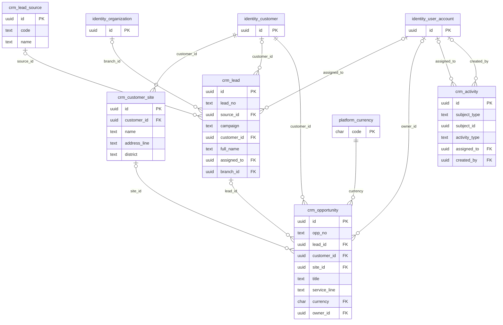

## catalog (5 tables)

category, product, variant, price_list, price_list_item

```mermaid
erDiagram
  catalog_category {
    uuid id PK
    uuid parent_id FK
    text slug
    text name
    integer sort_order
  }
  catalog_product {
    uuid id PK
    uuid category_id FK
    text product_type
    text brand
    text model
  }
  catalog_variant {
    uuid id PK
    uuid product_id FK
    text sku
    text name
    jsonb attributes
    char cost_currency FK
  }
  catalog_price_list {
    uuid id PK
    text code
    text name
    char currency FK
    text customer_type
  }
  catalog_price_list_item {
    uuid id PK
    uuid price_list_id FK
    uuid variant_id FK
    numeric unit_price
    numeric min_qty
    timestamptz created_at
  }
  billing_invoice_line {
    uuid id PK
  }
  billing_receipt_line {
    uuid id PK
  }
  inventory_goods_receipt_line {
    uuid id PK
  }
  inventory_po_line {
    uuid id PK
  }
  inventory_serial_unit {
    uuid id PK
  }
  inventory_stock_level {
    uuid variant_id PK
    uuid warehouse_id PK
  }
  inventory_stock_movement {
    uuid id PK
  }
  inventory_stock_reservation {
    uuid id PK
  }
  maintenance_asset {
    uuid id PK
  }
  maintenance_work_order_part {
    uuid id PK
  }
  platform_currency {
    char code PK
  }
  quotes_design_bom_item {
    uuid id PK
  }
  quotes_quote_line {
    uuid id PK
  }
  sales_cart_item {
    uuid id PK
  }
  sales_delivery_note_line {
    uuid id PK
  }
  sales_order_line {
    uuid id PK
  }
  catalog_category |o--o{ catalog_category : "parent_id"
  catalog_category ||--o{ catalog_product : "category_id"
  catalog_product ||--o{ catalog_variant : "product_id"
  platform_currency |o--o{ catalog_variant : "cost_currency"
  platform_currency ||--o{ catalog_price_list : "currency"
  catalog_price_list ||--o{ catalog_price_list_item : "price_list_id"
  catalog_variant ||--o{ catalog_price_list_item : "variant_id"
  catalog_variant ||--o{ inventory_po_line : "variant_id"
  catalog_variant ||--o{ inventory_goods_receipt_line : "variant_id"
  catalog_variant ||--o{ inventory_serial_unit : "variant_id"
  catalog_variant ||--o{ inventory_stock_level : "variant_id"
  catalog_variant ||--o{ inventory_stock_movement : "variant_id"
  catalog_variant ||--o{ inventory_stock_reservation : "variant_id"
  catalog_variant ||--o{ quotes_design_bom_item : "variant_id"
  catalog_variant |o--o{ quotes_quote_line : "variant_id"
  catalog_variant ||--o{ sales_cart_item : "variant_id"
  catalog_variant ||--o{ sales_order_line : "variant_id"
  catalog_variant |o--o{ maintenance_asset : "variant_id"
  catalog_variant ||--o{ maintenance_work_order_part : "variant_id"
  catalog_variant |o--o{ billing_invoice_line : "variant_id"
  catalog_variant |o--o{ billing_receipt_line : "variant_id"
  catalog_variant |o--o{ sales_delivery_note_line : "variant_id"
```

## inventory (10 tables)

warehouse, supplier, purchase_order, po_line, goods_receipt, goods_receipt_line, serial_unit, stock_level, stock_movement, stock_reservation

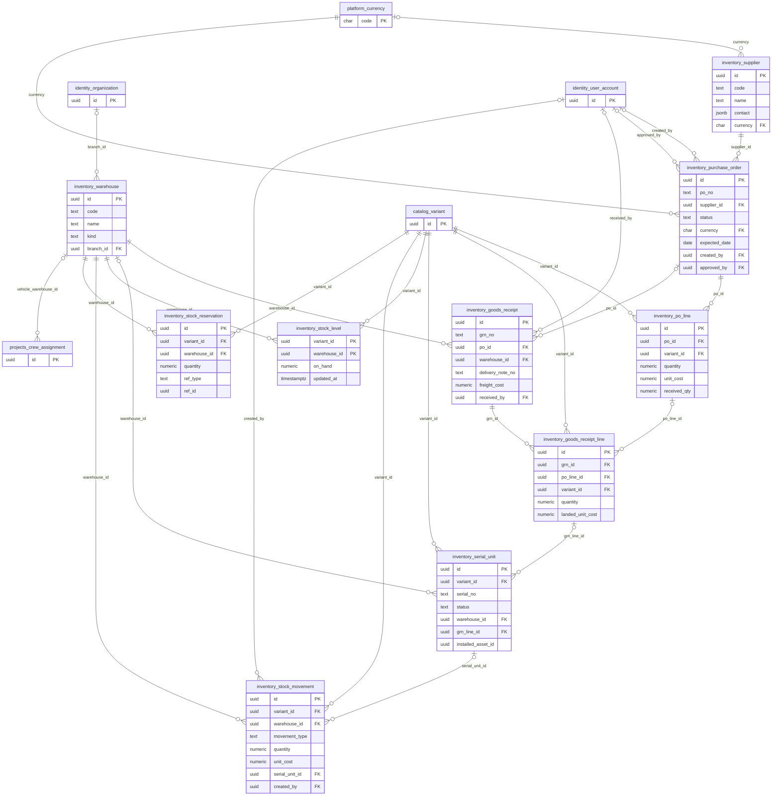

## quotes (8 tables)

site_survey, energy_profile, energy_profile_item, system_design, design_bom_item, quote, quote_version, quote_line

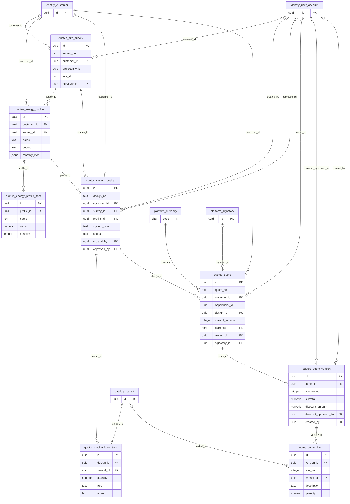

## sales (8 tables)

cart, cart_item, sales_order, order_line, shipment, return_request, delivery_note, delivery_note_line

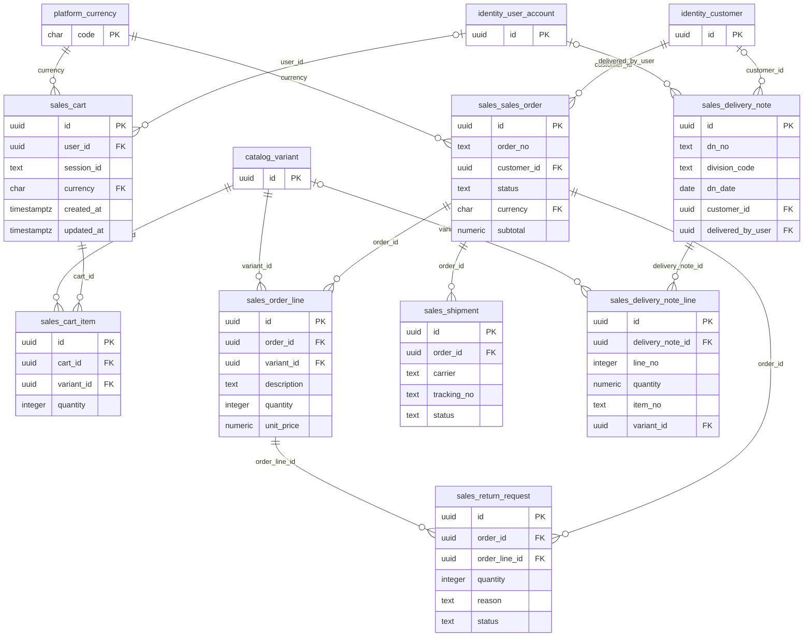

## projects (12 tables)

project_template, project, milestone, task, crew, crew_member, crew_assignment, checklist_template, checklist_item_template, checklist_response, commissioning_record, project_cost

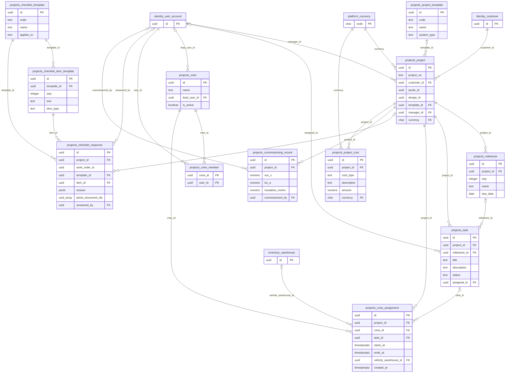

## maintenance (10 tables)

asset, warranty, service_contract, contract_asset, maintenance_schedule, ticket, warranty_claim, work_order, work_order_part, visit_report

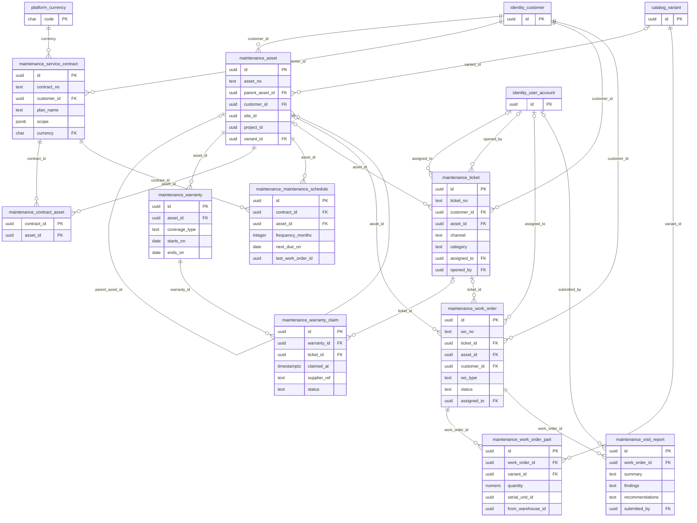

## consulting (4 tables)

consultation_service, booking, engagement, deliverable

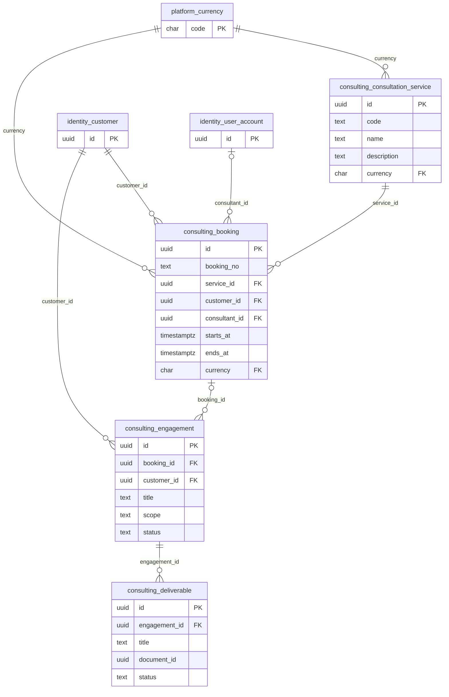

## billing (13 tables)

tax_rate, invoice, invoice_line, payment_attempt, payment, payment_allocation, payment_plan, payment_plan_installment, credit_note, receipt, receipt_line, payment_voucher, payment_voucher_line

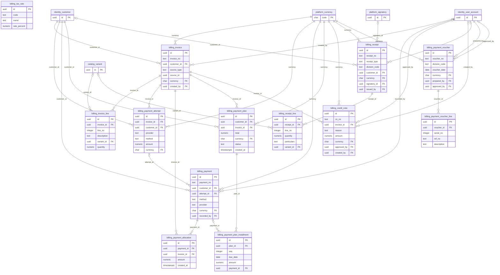
