[Use cases](#u)[Data flow](#f)[Site maps](#m)[Access](#r)[Infrastructure](#i)[Operations](#o)

# TCOIN SOLAR UG: Requirements and Operations Drawings

Companion to the diagram pack and ERD pack. TCOIN UG: We Plan and Do.

## 1. Use cases

### 1.1 Use case overview by actor

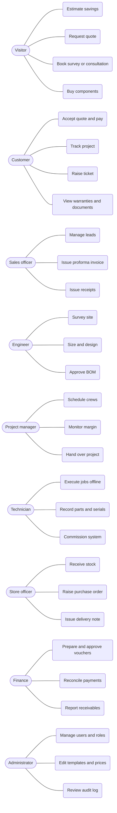

## 2. Data flow

### 2.1 DFD level 0

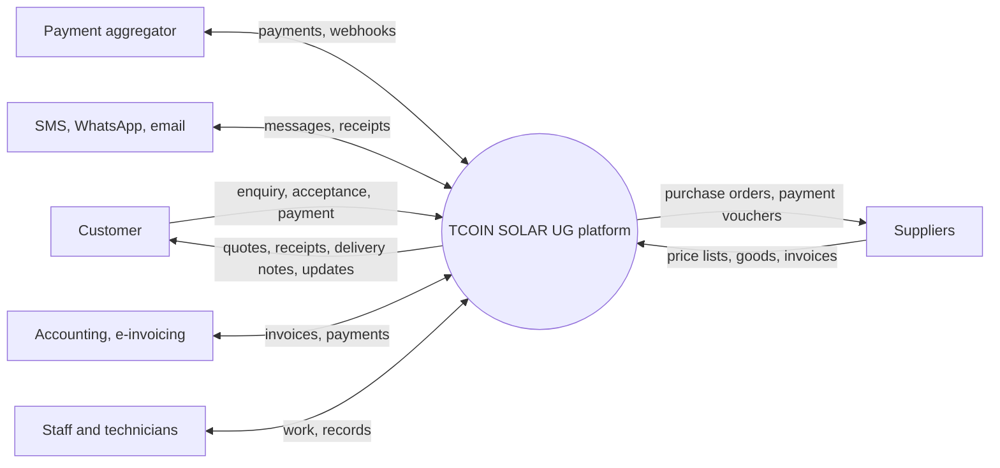

### 2.2 DFD level 1

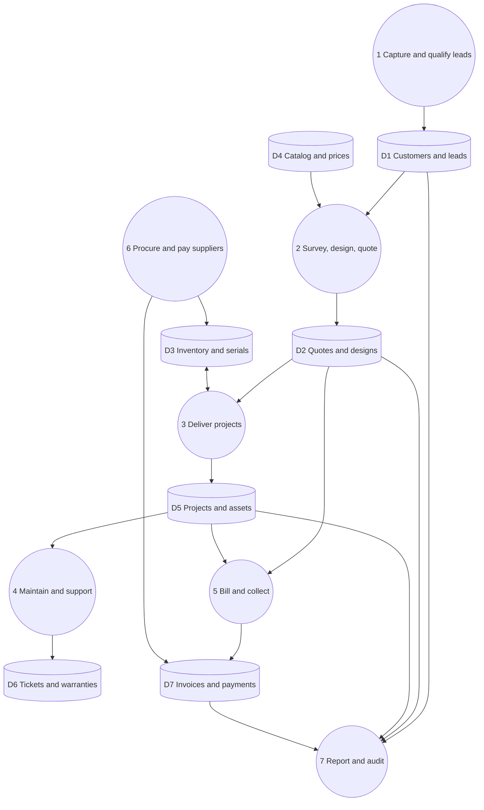

## 3. Site maps and page maps

### 3.1 Public website and store

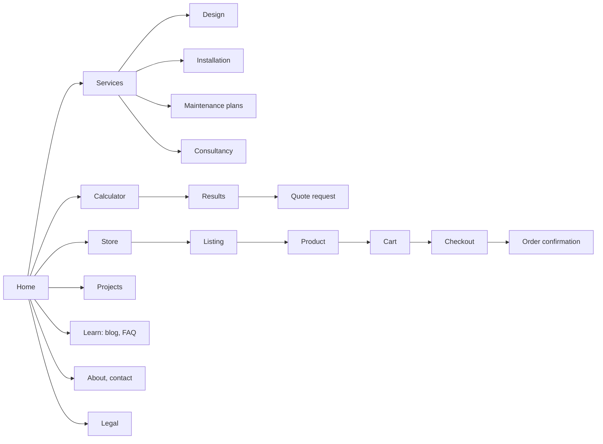

### 3.2 Customer portal

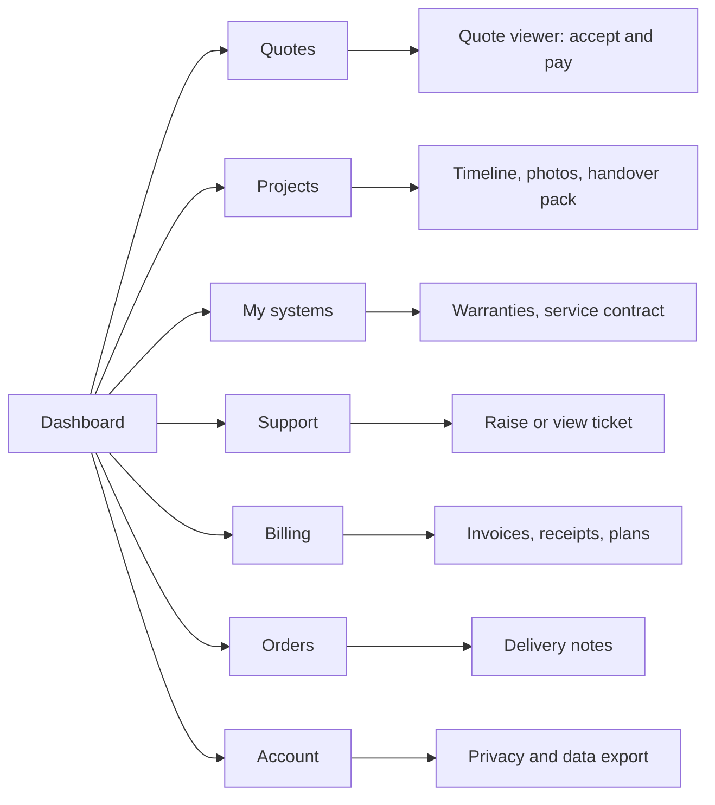

### 3.3 Staff console

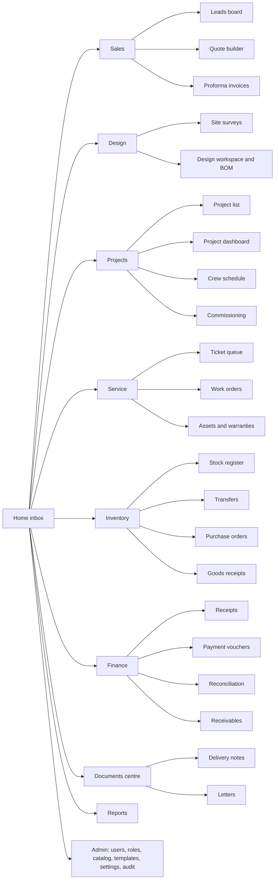

### 3.4 Technician app

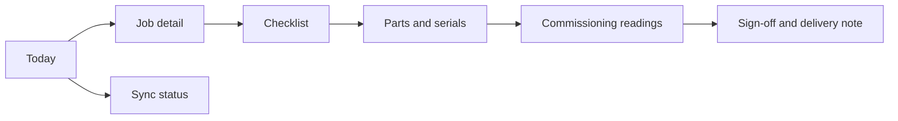

## 4. Access control

### 4.1 Role by module (R read, W write, A approve, own = own records only)

| Module                            | Admin | Director | Sales | Engineer | Project mgr | Technician  | Store | Finance | Customer      |
| --------------------------------- | ----- | -------- | ----- | -------- | ----------- | ----------- | ----- | ------- | ------------- |
| Leads and CRM                     | RW    | R        | RW    | R        | R           |             |       |         |               |
| Design and BOM                    | RW    | R        | R     | RWA      | R           |             | R     |         | own R         |
| Quotes and proforma               | RW    | RA       | RW    | RW       | R           |             |       | R       | own R, accept |
| Projects and schedule             | RW    | R        | R     | R        | RWA         | assigned RW | R     | R       | own R         |
| Inventory and POs                 | RW    | RA       | R     | R        | R           | parts       | RW    | R       |               |
| Receipts and invoices             | RW    | R        | RW    |          | R           |             |       | RWA     | own R, pay    |
| Payment vouchers                  | RW    | RA       |       |          |             |             | W     | RWA     |               |
| Delivery notes                    | RW    | R        | R     |          | RW          | sign        | RW    | R       | own R         |
| Tickets and work orders           | RW    | R        | R     | R        | RW          | assigned RW | R     |         | own RW        |
| Reports                           | R     | R        | own   | own      | R           |             | R     | R       |               |
| Users, roles, templates, settings | RWA   | R        |       |          |             |             |       |         |               |

### 4.2 How a customer request is authorised

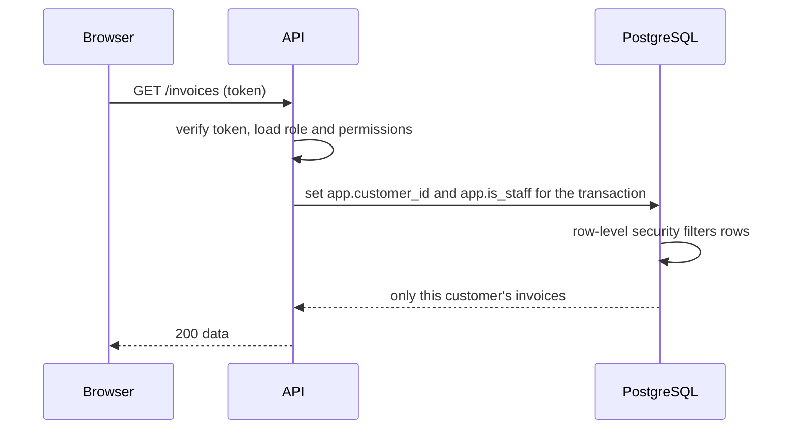

## 5. Infrastructure

### 5.1 Network zones

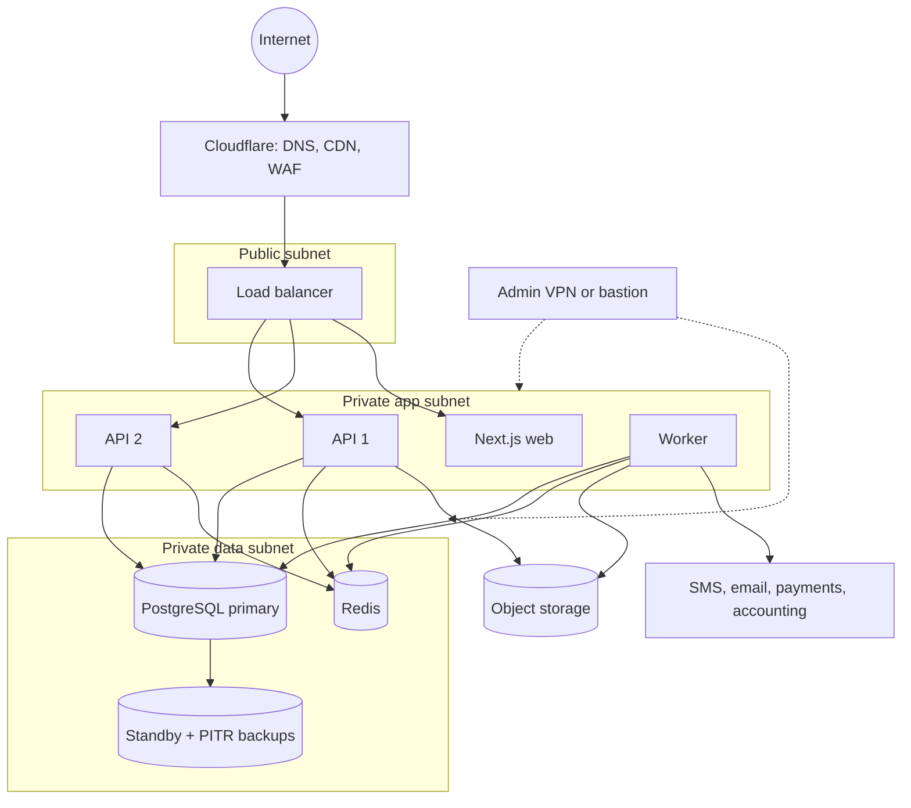

### 5.2 Backup and recovery

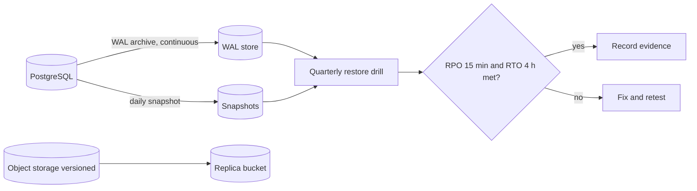

## 6. Operations

### 6.1 Domain events and consumers

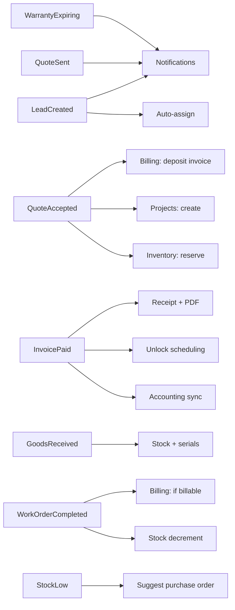

### 6.2 Procurement to payment

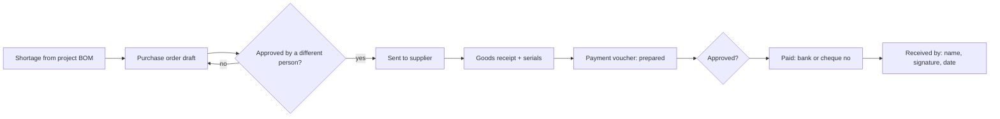

### 6.3 Offline sync states on the technician device

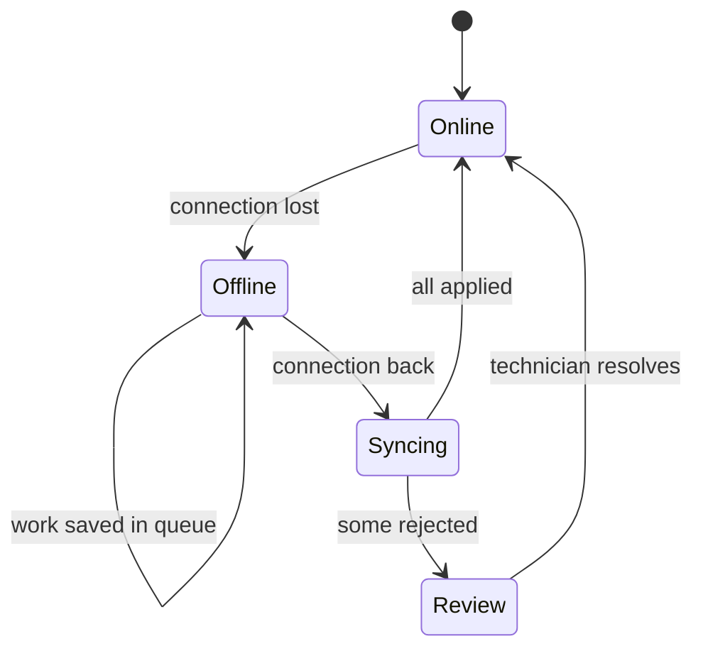

### 6.4 Ticket SLA timers

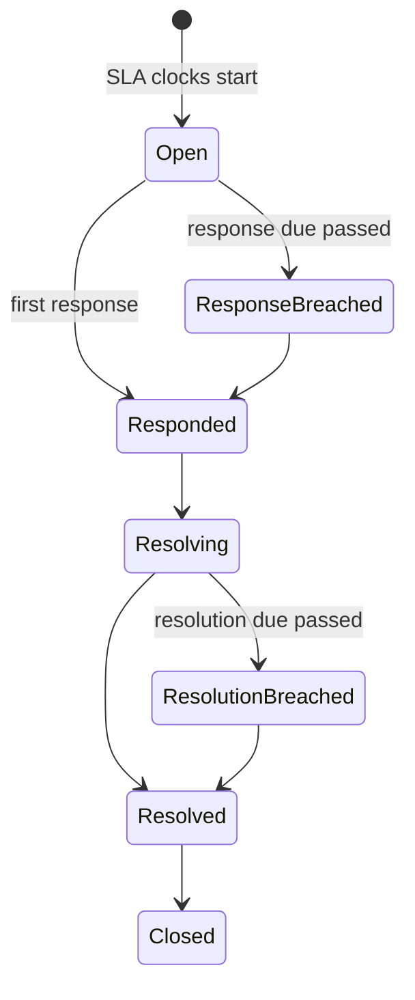

### 6.5 Notification pipeline

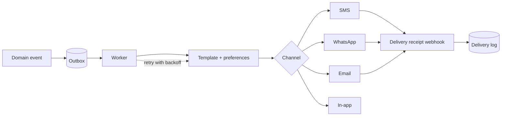

### 6.6 Data retention

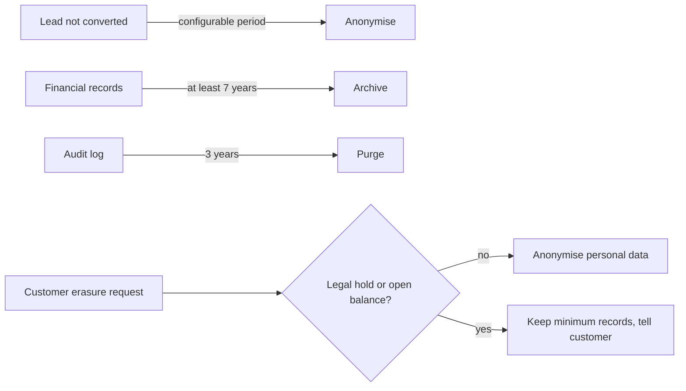

### 6.7 Backend module layering

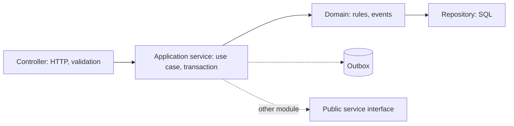
